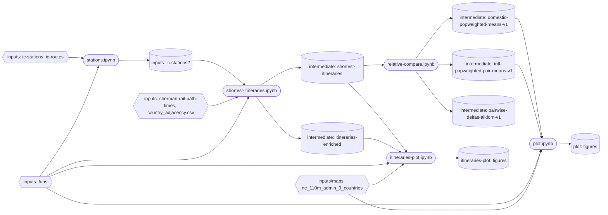
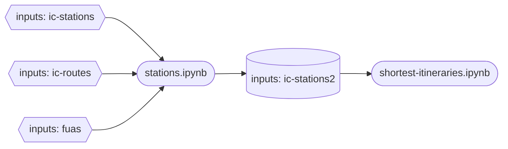
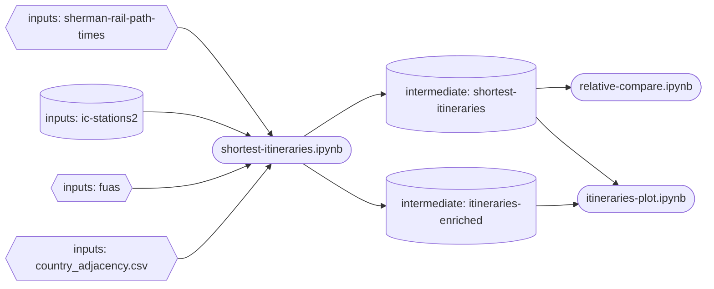
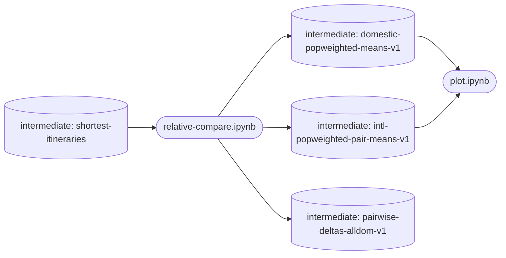
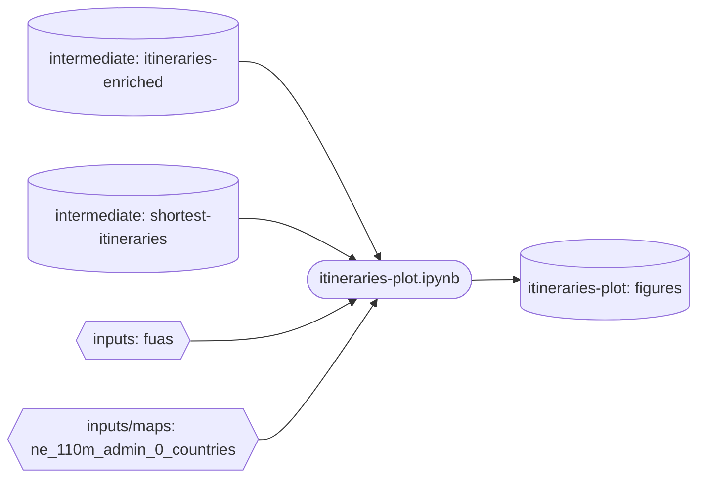
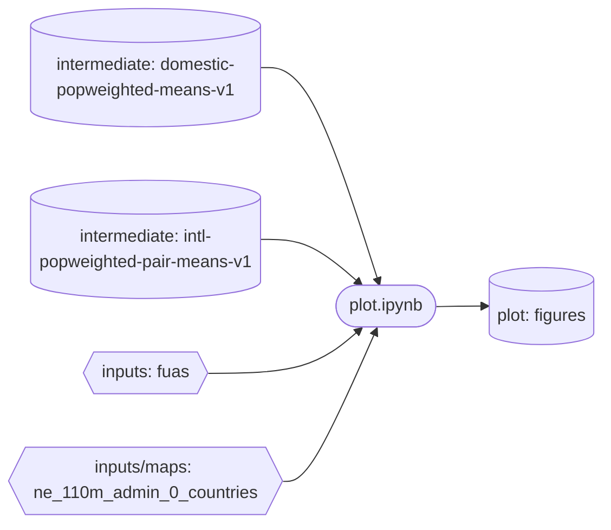

# Journal pipeline

Notebook pipeline for station-level rail itineraries, FUA-pair shortest times, domestic and international speed comparisons, and figures. All paths are relative to `journal/`.

## 1. Overview

The pipeline runs five notebooks in sequence. Each stage reads the previous stage's outputs and writes its own.

- **Stations:** keep stations served by rail routes, attach FUA and country, rank stations per FUA.
- **Shortest itineraries:** for each origin-destination FUA pair, keep the itinerary with minimum generalised travel time (GTT) and derive OD features.
- **Relative comparison:** population-weighted reference means for domestic OD pairs and for neighbouring-country pairs.
- **Itineraries plot:** FUA reach maps, reach graph, and country-level reach summaries.
- **Plot:** country network maps and distribution plots comparing domestic and international speed.

Conceptual flow: stations, then shortest itineraries, then comparison and plotting. The two plotting stages branch off the shortest-itineraries outputs.

Legend for all diagrams:
- Stadium shape `([ ])`: notebook.
- Cylinder shape `[( )]`: data product or figure set.
- Hexagon shape `{{ }}`: external input.
- `inputs:` prefix: `inputs/`. `intermediate:` prefix: `outputs/v2/intermediate/`. `plot:` and `itineraries-plot:` prefixes: `outputs/v2/plot/` and `outputs/v2/itineraries-plot/`.

## 2. Pipeline

## 3. Prerequisites

- Python environment with the packages imported by the notebooks and by `lib/`.
- Input files present under `inputs/`:
  - `inputs/ic-stations.parquet`, `inputs/ic-routes.parquet`: used by stations.
  - `inputs/fuas.parquet`: used by stations, shortest itineraries, itineraries plot, and plot.
  - `inputs/sherman-rail-path-times.parquet`: raw itineraries, used by shortest itineraries.
  - `inputs/country_adjacency.csv`: used by shortest itineraries.
  - `inputs/maps/ne_110m_admin_0_countries/`: basemap, used by itineraries plot and plot.
- Output folders `outputs/v2/intermediate/`, `outputs/v2/itineraries-plot/`, and `outputs/v2/plot/` must exist.

## 4. Run order

1. [stations.ipynb](stations.ipynb)
2. [shortest-itineraries.ipynb](shortest-itineraries.ipynb)
3. [relative-compare.ipynb](relative-compare.ipynb) and [itineraries-plot.ipynb](itineraries-plot.ipynb) (independent of each other; both need step 2)
4. [plot.ipynb](plot.ipynb) (needs step 3)

## 5. Stages

### 5.1 stations.ipynb

Purpose: define the station universe, with FUA and country attached, and rank stations per FUA by route coverage.

Inputs: `inputs/ic-stations.parquet`, `inputs/ic-routes.parquet`, `inputs/fuas.parquet`.

Operation:
- Keep rail routes. Count routes per station. Drop stations with no rail routes.
- Compute great-circle distance from each station to its FUA centroid.
- Attach FUA name and country (ICC) to each station.
- Per FUA, run a greedy set cover over routes to mark core stations and route-coverage shares.

Outputs: `inputs/ic-stations2.parquet`, indexed by `stn_id`. Written into `inputs/`; consumed by shortest itineraries.

Library: `lib/geoutils.py` (`great_circle_distance_km`).

### 5.2 shortest-itineraries.ipynb

Purpose: select the minimum-GTT itinerary per FUA pair and derive OD features.

Inputs: `inputs/sherman-rail-path-times.parquet`, `inputs/ic-stations2.parquet`, `inputs/fuas.parquet`, `inputs/country_adjacency.csv`.

Operation:
- Join origin and destination FUAs and countries. Attach adjacency class to each OD.
- Compute straight-line OD distance and derive speed and circuity features.
- Compute GTT = in-vehicle time + 1.7 × transfer time + 10 × transfers.
- Keep one itinerary per FUA pair with minimum GTT. Ties: fewer transfers, then shorter time, then lower id.

Outputs:
- `outputs/v2/intermediate/shortest-itineraries.parquet`: selected itinerary per FUA pair.
- `outputs/v2/intermediate/itineraries-enriched.parquet`: all itineraries with GTT.

Library: `lib/shortest_iti.py` (`Config`, `build_shortest_itineraries`, `export_results`), `lib/geoutils.py`.

### 5.3 relative-compare.ipynb

Purpose: population-weighted reference means for domestic OD pairs and for neighbouring-country pairs.

Inputs: `outputs/v2/intermediate/shortest-itineraries.parquet`.

Operation:
- Keep OD pairs within 600 km of each other by straight-line distance.
- Classify domestic pairs (adjacency 0) and neighbour pairs (adjacency 1). Adjacency 2 is excluded.
- Domestic means: population-weighted mean of each metric per country.
- International means: population-weighted mean per unordered neighbouring-country pair, mirrored into both directions.
- Delta path: compares each international OD with domestic ODs in both endpoint countries and aggregates to pairs. Written to file only.

Outputs (all in `outputs/v2/intermediate/`):
- `domestic-popweighted-means-v1.parquet`: indexed by country.
- `intl-popweighted-pair-means-v1.parquet`: one row per direction of each pair.
- `pairwise-deltas-alldom-v1.parquet`: no downstream notebook reads this file.

Library: `lib/relative_compare.py` (`compute_intl_pair_means`, `compute_domestic_popweighted_means`, delta functions).

### 5.4 itineraries-plot.ipynb

Purpose: FUA-level reach maps, reach graph, and country-level reach summaries.

Inputs: `outputs/v2/intermediate/itineraries-enriched.parquet`, `outputs/v2/intermediate/shortest-itineraries.parquet`, `inputs/fuas.parquet`, `inputs/maps/ne_110m_admin_0_countries/`.

Operation:
- Exclude listed countries and FUAs.
- Reach per source FUA = maximum adjacency class over direct (zero-transfer) itineraries. Mapped in four classes (0 to 3).
- Maps and histograms of reach. Country-level reach shares.
- Reach graph: undirected FUA graph from direct links with adjacency of at least 1. Nodes with degree of at least 10, spring layout.
- Edge-level maps for maximum adjacency k = 1, 2, 3.
- Directed country heatmap and degree distributions.

Outputs: `outputs/v2/itineraries-plot/`. Figures in `.jpg` and `.pdf`: `fua_distribution_map`, `max_reach_map`, `max_reach_map_edge1` to `edge3`, `reach_histogram`, `fua_graph_spring`, `country_reach_hist`, `country_heatmap`, `reach_deg_distr`.

Library: `lib/utils_plotting.py` (`make_basemap`, `set_nodesize_logscale`).

### 5.5 plot.ipynb

Purpose: country network maps and distribution plots comparing domestic and international speed and transfers.

Inputs: `outputs/v2/intermediate/domestic-popweighted-means-v1.parquet`, `outputs/v2/intermediate/intl-popweighted-pair-means-v1.parquet`, `inputs/fuas.parquet`, `inputs/maps/ne_110m_admin_0_countries/`.

Operation:
- Exclude listed countries.
- Population-weighted country centroids from FUA centres.
- Country network maps: edges are international pair means, nodes are domestic means. Exported as `.jpg` and `.pdf`.
- ECDFs of pair-level means for speed, in-vehicle speed, transfers, and circuity.
- Range plots of international in-vehicle speed against domestic values at each endpoint.

Outputs: `outputs/v2/plot/`. Figures in `.jpg` and `.pdf`: `graph-v2-speed_inveh_abs`, `graph-v2-speed_abs`, `graph-v2-speed_net_abs`, `graph-v2-n_trans_abs`, `graph-v2-circuity_osm_od_abs`, `histplot-ot-speed-ecdf`, `histplot-ntransfers-ecdf`, `histplot-circuity-ecdf`, `pair-speed_inveh-range`, `pair-speed-range`.

Library: `lib/plot.py` (`plot_country_network`, `add_cmap_and_normalise`).

